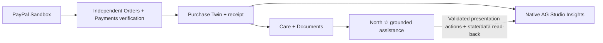

# Pal Care

**A purchase is the beginning of care.** Pal Care turns saved purchases into a useful ownership record: find the right receipt, understand available aftercare evidence, and explore your purchases with North ☆ and native AG Studio Insights.

**[Open the live demo](https://palcare-judge.onrender.com)** · [Judge walkthrough](docs/JUDGING.md) · [PayPal proof](docs/PAYPAL-INTEGRATION-PROOF.md) · [Implementation and release evidence](docs/STATUS.md)

Public fictional demo. **No login, account setup or AI token entry.** Hosted North uses DeepSeek Flash with automatic, limited guest sessions. Sandbox payments use test money; payment-changing operations are disabled on the hosted demo.

## Start here for judges

1. Open **[Care](https://palcare-judge.onrender.com/dashboard)**, then **Purchases & Docs**.
2. Choose **Everyday headphones · October 22, 2026 · $129.00 · Verified Sandbox**. This is distinct from the October 18 example headphones purchase. [Open the verified purchase](https://palcare-judge.onrender.com/vault/21301174-dcfa-4e19-b5cc-18f21e745700).
3. Inspect its **[saved receipt](https://palcare-judge.onrender.com/documents/aee87787-6493-4e6d-8b48-175317fc1be5)**, Documents and Care information. Keep each source's provenance in view: a verified payment does not verify an attached warranty or return policy.
4. Open **North ☆** for that purchase and ask **“What warranty evidence is saved for this purchase?”** Then say **“Show me its receipt”** or **“Take me there.”** Resolved navigation uses the exact selected record without another model call.
5. Open **[Insights](https://palcare-judge.onrender.com/insights)** and ask **“Create a category chart for my saved purchases.”** North applies a supported view to real native Studio components; success requires SDK state and scoped-data read-back. Try category cross-filtering and inspect the corresponding grid/KPIs.

North is pronounced **North Star**. It provides grounded help and presentation actions, not payment/refund authority. Missing evidence remains missing. [Full walkthrough and verification limits](docs/JUDGING.md).

## Why PayPal + AG Grid work better together

PayPal supplies the **verified transaction evidence**. Pal Care turns it into a durable **Purchase Twin** with a receipt and linked aftercare information. North makes that information accessible through natural questions and validated actions. AG Studio makes the saved purchase data **interactive and inspectable**, rather than leaving it in a chat answer.



The verification pipeline was exercised against real PayPal Sandbox APIs on **October 22, 2026**. Render displays a **sanitized historical copy** of that purchase; it does not create or reverify a payment when a judge opens the demo. [Pipeline, evidence and limitations](docs/PAYPAL-INTEGRATION-PROOF.md).

## What you can explore

| Experience | Implemented behavior |
| --- | --- |
| **Care** | Source-backed purchase/status cards and a custom Care timeline running through AG Studio's data API; illustrative events are labeled. |
| **Purchases & Docs** | Dated purchase browsing, document categories and direct saved receipt/document links. |
| **North ☆** | Hosted DeepSeek Flash, source-grounded purchase help, preserved conversations and exact purchase context; provider-free navigation after resolution. |
| **Insights** | Native AG Studio grids, charts and KPIs using AG Grid/AG Charts; cross-filtering, custom evidence widgets and browser-local saved layouts. |
| **North-driven Insights** | Bounded model plans applied through the Studio integration, including Agent Framework tools where used, with actual SDK state and resulting data verified before completion is reported. |

### Keep the evidence distinct

- **One $129 Sandbox purchase:** genuine historical PayPal capture and independent Orders/Payments verification; test money, fictional goods.
- **Other purchases and example aftercare:** illustrative. Attached fictional merchant policies do not become genuine coverage because their parent payment was verified.
- **Official care sources:** separately attributed and scoped to the matching product/model. The headphones do not have a manufacturer manual on file.
- **Disabled or incomplete:** hosted checkout/refunds/payment-provider reads and workers are off. Webhooks are **not yet implemented**. No live delivery tracking, universal PayPal history, guaranteed warranty coverage or verified refund is claimed.

## Inspect the implementation

| Technical relationship | Source |
| --- | --- |
| Official PayPal Server SDK; Sandbox Orders/Payments adapter | [`paypal.ts`](src/lib/commerce/paypal.ts) |
| Buyer approval, persisted idempotency, capture-attempt marker, atomic purchase/receipt creation | [`service.ts`](src/lib/commerce/service.ts) |
| Independent order/capture matching and completed-payment evidence | [`verification.ts`](src/lib/commerce/verification.ts) |
| Shared saved-purchase ownership evidence for Care and North | [`ownership.ts`](src/lib/care/ownership.ts) |
| Hosted DeepSeek strict function-output serialization and original application validation | [`deepseek-request.ts`](src/lib/careos/providers/deepseek-request.ts), [`responses.ts`](src/lib/careos/providers/responses.ts) |
| Owned follow-ups, exact-product resolution and grounded answers | [`conversation-service.ts`](src/lib/careos/records/conversation-service.ts), [`grounding.ts`](src/lib/careos/grounding.ts) |
| Provider-free selected-purchase navigation to existing records | [`navigation-record.ts`](src/lib/careos/navigation-record.ts), [`provider.tsx`](src/components/careos/provider.tsx) |
| Native widget types, mappings and default dashboard state | [`customer-state.ts`](src/lib/intelligence/customer-state.ts) |
| Studio execution, filters, saved layouts and SDK/data postconditions | [`customer-studio.tsx`](src/components/intelligence/customer-studio.tsx) |
| Real Studio Agent Framework runner for typed customer presentation commands | [`customer-agent.ts`](src/components/intelligence/customer-agent.ts) |
| Custom Care calendar backed by Studio widget data queries | [`calendar-studio.tsx`](src/components/care/calendar-studio.tsx) |

**Architecture:** one Next.js modular monolith, server-side PayPal/model integrations, restricted PostgreSQL access and shared domain services. North's internal service namespace is **CareOS**. Models propose bounded tasks; application code resolves records, computes amounts and validates actions. Provider credentials stay server-side.

**Stack:** Next.js 16, React 19, TypeScript, Tailwind CSS, Drizzle/PostgreSQL, official PayPal Server SDK **2.5.0**, DeepSeek Flash, AG Studio/React **3.0.0**, Vitest and Playwright. Exact versions are in [package.json](package.json) and [pnpm-lock.yaml](pnpm-lock.yaml).

## Run a local fixture preview

Requires Node.js **22.23.x** and pnpm **10.34.7**. In a fresh clone on your development machine:

```bash
git clone https://github.com/fmruslan/Pal-Care-Ruslan.git
cd Pal-Care-Ruslan
corepack enable
pnpm install --frozen-lockfile
pnpm workspace:check
DEMO_DATA_SOURCE=fixtures APP_ORIGIN=http://127.0.0.1:3000 pnpm dev
```

Open `http://127.0.0.1:3000`. No database or credentials are required for the labeled fixture preview. It does **not** reproduce live DeepSeek or seed the verified Sandbox purchase. Use the hosted demo for the accepted live journey. Local Studio evaluation requires the existing explicit `AG_STUDIO_LOCAL_EVALUATION_ENABLED=true` setting and applicable vendor terms; preserve its watermark.

On a separate, non-serving development checkout:

```bash
pnpm lint
pnpm test
pnpm build
pnpm exec playwright install chromium
pnpm test:e2e
```

PostgreSQL integration tests require a dedicated `TEST_DATABASE_URL`, never the deployed database. [Setup](docs/SETUP.md) · [Hosted configuration](docs/RENDER-JUDGE.md) · [CI/release policy](docs/CI-POLICY.md). The protected GreatBison preview is not a judge setup path; its workspace guard must remain intact.

## Access, license and submission

- **Requested public availability:** through **December 31, 2026, 11:59 PM Pacific**. The configured hosted cutoff is January 1, 2027 at 08:00 UTC, exclusive. Automatic guest grants last at most 24 hours; expired guests can be admitted again within that window, without resetting the global usage ledger. [Current settings, funding dependencies and status](docs/RENDER-JUDGE.md).
- **Bounded AI:** existing rate limits and the shared $18 daily/total application cap apply. Hosting/database funding and remaining DeepSeek credits are operational dependencies; a future uptime or unlimited-inference guarantee is not claimed.
- **Application source:** [MIT](LICENSE). AG Studio/AG Grid/AG Charts have separate vendor terms; the project's MIT license does not license those components. AG Grid's published hackathon guidance promises judging-period license support, but an issued/configured key and coverage through December 31 are **not confirmed**. Vendor watermark/notices remain visible. [Exact license status](docs/AG-STUDIO-JUDGING-LICENSE.md).
- **Source attribution:** Raspberry Pi excerpts/derived care summaries retain [CC BY-SA 4.0 attribution](docs/CARE-SOURCES.md); bundled fonts retain their [license notices](public/licenses/).
- **Submission cutoff:** November 12, 2026, noon Pacific. Final video/submission and exact release evidence are tracked in [Judging](docs/JUDGING.md) and [STATUS](docs/STATUS.md).

Pal Care is an independent hackathon project, not an official PayPal product or a warranty/insurance provider. [Security](SECURITY.md) · [Contributing](CONTRIBUTING.md) · [Archived development README](README-HISTORY.md).
